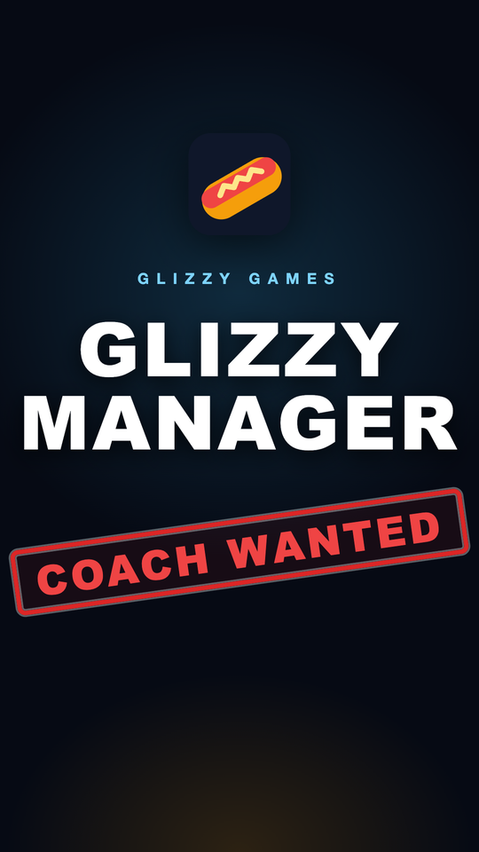
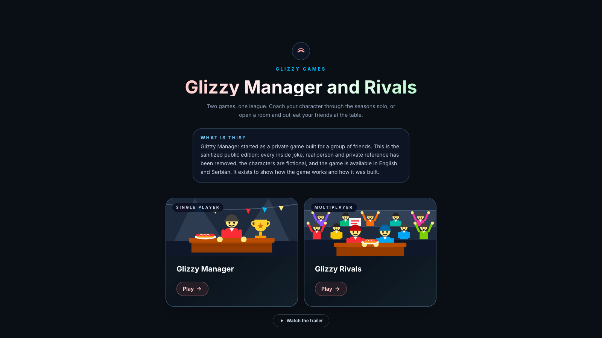
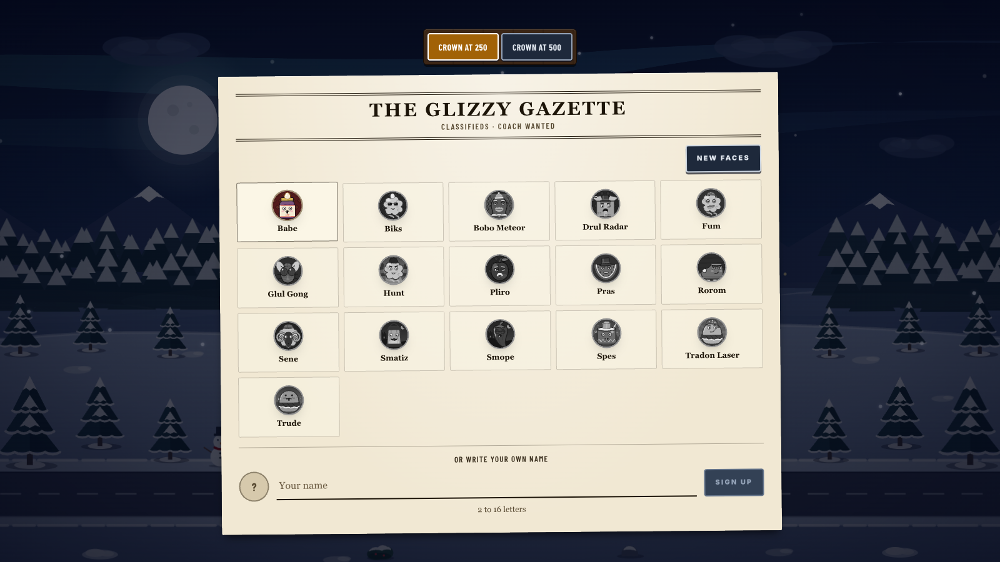
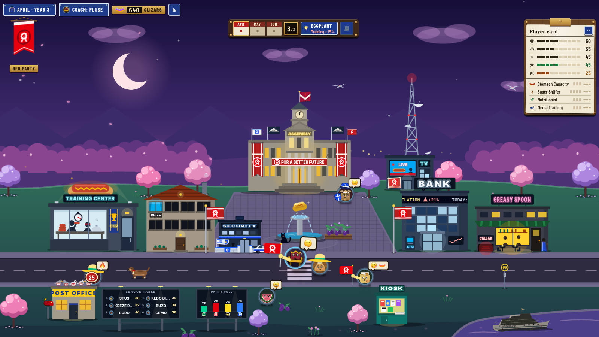
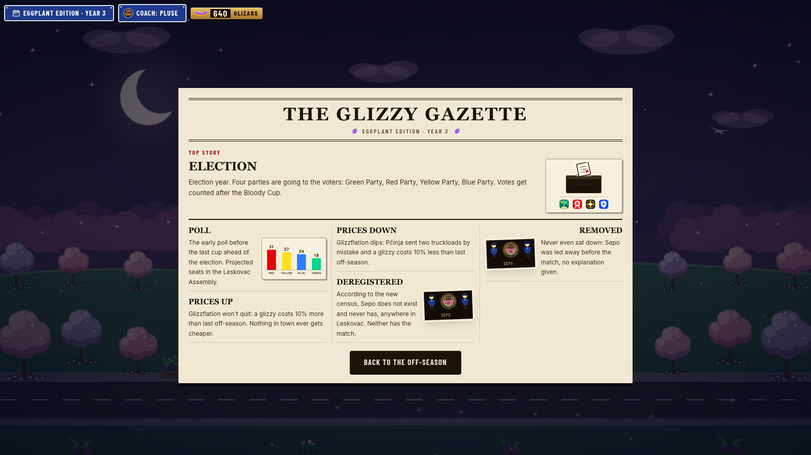
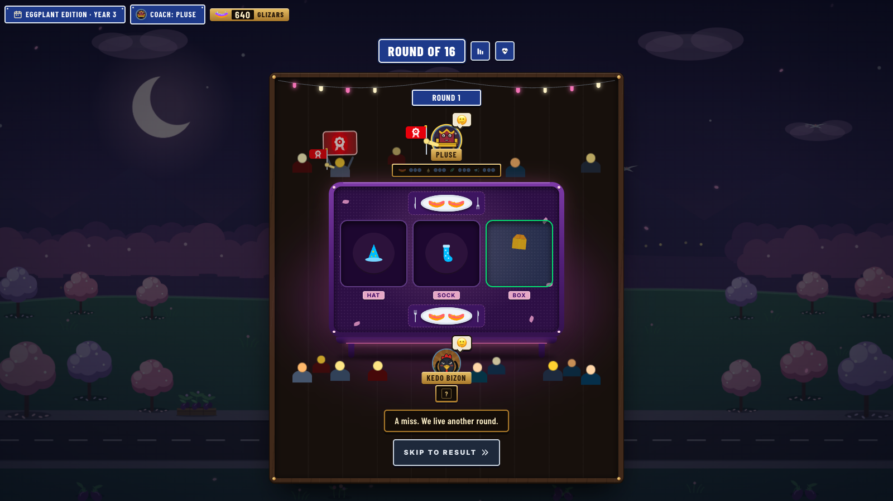
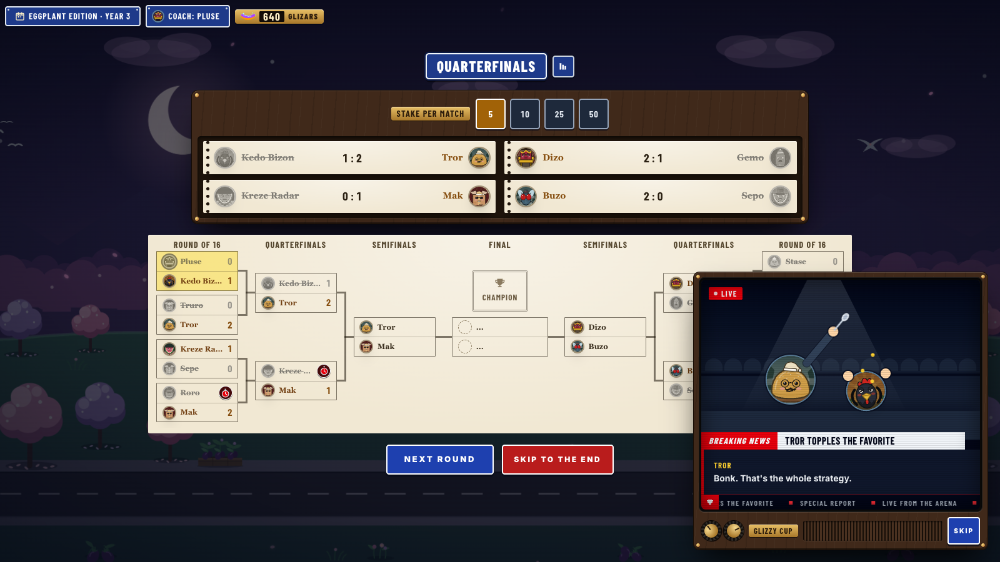
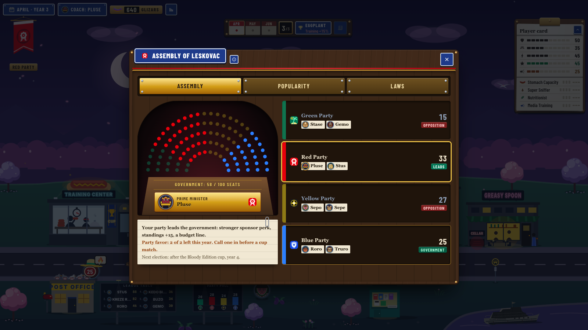
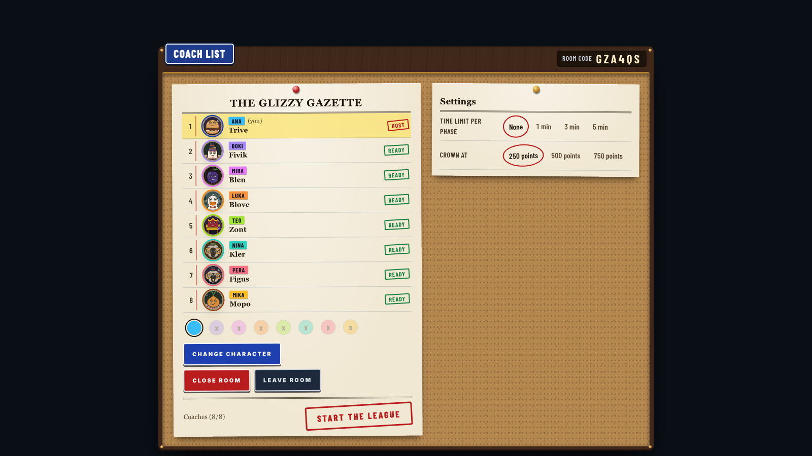

# Glizzy Manager

[](public/trailer/glizzy-manager-trailer.mp4)

**[Watch the trailer](public/trailer/glizzy-manager-trailer.mp4)** (vertical, English narration, [captions](public/trailer/glizzy-manager-trailer.vtt)).

This is a public port of a game that was made for a group of friends. The
original is full of inside jokes, real people and private references; this
edition replaces the private characters with generated fictional ones, swaps
the private material for generic content, and translates everything to
English, with Serbian kept as a second language. It is here to show how
the game was built, not to be the original.

The game itself: a management sim about a professional hot-dog eating league,
narrated like a deadpan sports broadcast. You coach one eater from a league
of generated characters (or one with your own name) through season after
season, working the off-season from a small night town: train them, chase
cup runs, sign sponsors who double as political parties, vote laws through
the Assembly, read the morning paper, sabotage a rival now and then, and
collect achievements along the way. Two modes share one engine:
**Glizzy Manager** is the single-player career at `/manager`, and **Glizzy
Rivals** is the same league played live in a room of up to eight coaches at
`/rivals`.

## Contents

- [Features](#features)
- [Trailer and screenshots](#trailer-and-screenshots)
- [How Rivals stays in sync](#how-rivals-stays-in-sync)
- [Quick start](#quick-start)
- [Environment](#environment)
- [Scripts](#scripts)
- [Checks and simulations](#checks-and-simulations)
- [Languages](#languages)
- [Project layout](#project-layout)
- [Design notes](#design-notes)
- [Audio and art](#audio-and-art)
- [Deployment](#deployment)
- [What was changed for the public edition](#what-was-changed-for-the-public-edition)
- [License](#license) and [Credits](#credits)

## Features

### Glizzy Manager (single player)

**The career**
- Three save slots in the browser, with continue, new career and delete.
- An intro cutscene, then you answer a "Coach wanted" ad in the classifieds,
  pick the crown (250 or 500 table points) and sign one of the applicants.
  Your eater starts as a comeback with almost no fame, seeded last.
- The first character to reach the crown's points is crowned **Glizzy
  Overlord** and the campaign ends. An AI coach can get there first, and a
  party can end it too, with a new constitution (see Sponsors and politics).
- Fifteen AI coaches with eight personalities (the Grinder, the Showman,
  the Schemer and others) play the same off-season you do.

**Generated characters**
- There is no fixed roster. Every league is 16 nicknames generated from a
  seed, made only of letters that read the same in English and Serbian.
- A character is a function of its name: a hash of it draws the creature
  avatar (species, colors, face, gear and props) and rolls everything else,
  from the meters the character drifts back to and the season they are in
  form, to their party leanings, house party, old grudges and hiding habits.
- **New faces** draws a fresh set of applicants, and **Or write your own
  name** signs up a name of your own (2 to 16 letters) in the place of an
  applicant.

**The town**
- The off-season is a small town at night, one building per thing to do:
  the Training Center, home (rest or fast), the TV station (media, and the
  press conference when a new rival is due), the Greasy Spoon Café
  (sabotage), the security firm, the Bank, the Assembly and the party poll,
  the Post Office, the Kiosk (the papers and league stats), the League Table
  billboard and the Island Weekend dock.
- Click a building and your character walks over to it. A building stands
  abandoned until the career unlocks it and shuts once its move is spent
  for the window; when the three months are spent, the cup bus takes you to
  the cup.
- A HUD holds the calendar with the season's moves, your sponsor's banner,
  your player card and meters, and an alarm on election night.
- The rest of the league strolls the streets. Your investments show up in
  town (a guard booth, cameras, a patrol and a searchlight, a hot tub, the
  coach's tactics board, the informant's van), your party's flags fly over
  it, and the scenery and weather follow the season. A stray dog and a black
  cat live there too.
- The interface is drawn as street furniture: brass plates, wooden boards,
  paper sheets and street-name plates, and the Rivals lobby is a cork
  noticeboard.

**The year**
- Four seasons a year. Each one is an off-season of three monthly
  activities, then the morning paper, then a cup.
- A calendar to browse past years: cup results, elections and seasonal
  prices.
- Each season moves one price category up or down, announced by letter, and
  some characters are simply in form in their season.

**The off-season**
- **Training**: Stomach Capacity, Nutritionist and Media Training at three
  levels and Super Sniffer at four, plus sparring. Train the same thing
  without a break and you risk overtraining and losing a level.
- **Rest, fast, media** (an interview, or a scandal that may backfire), the
  Green Party's island weekend for its clients, and a security crew against
  sabotage.
- **Meters**: Cholesterol, Appetite, Ambition, Ego and Fame. Each character
  drifts back toward their own resting values. Too much ego and your eater
  books their own training; too little ambition and they hire guards or
  fast on their own.
- **Mood**: a mood bubble over your character and ambient mood sounds.
- **Permanent investments**, once you have a sponsor: bodyguards and a spa
  membership (four levels each), an assistant coach and a league informant,
  who fills in the opponent files bit by bit.
- **The Bank**: the Glizzflation chart with bets on the next price story (up,
  flat or down), the investments, and a loan counter with interest every
  off-season. Debt left standing for years first draws a letter, then a car.
- Every activity plays its own animated scene.

**Sponsors and politics**
- Four sponsors make offers by letter, and they are also the parties of the
  **Assembly of Leskovac**, 100 seats. Signing brings a fee every season, +10
  table points, +10 fame and the party's perk. The figures below are the
  base: fees, table points and most perks grow while the party leads the
  government and shrink in opposition.
  - **Blue Party** (70 a season): a permanent security crew that stops 60%
    of sabotage, and paid security up to 95% instead of 85%.
  - **Green Party** (80): the island weekend, once a year and without using up a
    month (cholesterol to zero, appetite and ambition to the max); sabotage
    25% cheaper with no fine for a miss, and while the Greens govern, evidence
    against you never reaches an indictment.
  - **Yellow Party** (60): 40 more for every cup win, and a loan of up to 300 at
    the Bank (500 while it leads, 200 in opposition), at 10% per off-season.
  - **Red Party** (60): state media, where appearances pay double with no
    once-a-season limit.
- Elections every two years: a poll, campaign donations, an election-night
  cutscene and a prime minister, the leading party's coach highest in the
  table. When no list has a majority, the coaches of the strongest one vote
  on a coalition partner. The ruling party rewards its clients and bills
  everyone else.
- **Laws**: once a term, after the Frozen cup of the year between elections,
  the prime minister puts one of three cards on the agenda: a new law, or the
  repeal of one in force. Any party can put up any law. Only government
  coaches vote, with weighted votes (the leading party over the partner, a
  player over an AI); a bill passes with 75% of the votes, and in a
  coalition also with half of the partner's. At most five laws stand at once
  (a full house deals only repeals), and a law stays until a government
  repeals it. The ten:
  - **Public Holiday**: every coach starts each off-season with 10 less
    cholesterol.
  - **State Lottery**: everyone pays 20 a season, and one coach drawn at
    random takes the pot at the end of the year.
  - **Training Subsidy**: training is 25% cheaper for everyone.
  - **Wealth Tax**: anyone holding over 500 pays 5% a season.
  - **Credit Act**: every coach can borrow 200 more at the Bank.
  - **Tourist Tax**: the opposition pays 30 a season, split among the
    government's coaches.
  - **Curfew**: every sabotage job has a 15% lower chance.
  - **Public Order Act**: sabotage costs double. It shares an area with
    Amnesty, so passing one repeals the other.
  - **Amnesty**: league penalties no longer cost the party votes.
  - **Fenced Grounds**: government coaches get +10% permanent security.
- **The constitution**: from year 11, a leading party holding at least two
  thirds of all seats can put a new constitution to the vote. It needs 80% of
  the government's votes; if it passes, the campaign ends and every coach on
  that list wins. A failed try costs the party 40 rating at every count
  after it.
- A big enough donation to a governing party buys a **favor**: an opponent
  removed from the bracket before a cup match.
- **Glizzflation**: a glizzy price index that moves most off-seasons and
  scales what training, guards, sabotage and investments cost. Price hikes
  hurt the government's rating.

**Rivals and sabotage**
- A rival each year (rolled from old grudges in year one, then picked at a
  press conference). Beating them in a cup pays.
- Three sabotage methods (diversion, nightmare, planted evidence), with the
  option to pay extra for better odds and a fine if it fails. Planted evidence can
  get the target arrested mid-match. Hits on your own eater play back as an
  overnight reel.

**The cup**
- A 16-eater knockout bracket seeded straight from the league table, with
  prize money for the podium.
- Matches are simulated and watched, not played. Each round a glizzy hides in
  a hat, a sock or a box. Stomach capacity is your eater's lives, and ties go
  to sudden-death overtime. A match can also end in a meltdown, an
  overeating, an arrest or a political removal.
- Bets on any match (stakes of 5 to 50, odds 1.1x to 2.5x). Betting
  against your own eater can leak to them.
- A tale of the tape before each match, a studio cup preview with title odds,
  weather and streaks, and a crowd in the stands.
- Watch any match, skip ahead, or withdraw from the cup.
- Features unlock as you go: sabotage, security and the commentator after the
  first cup, betting after the second, the studio preview after the third.

**Presentation**
- **The paper**: a newspaper after every off-season with headlines, stamps
  and charts. A **mailbox** at the Post Office for prize money, offers,
  donation calls and unlock letters.
- **Commentary**: voiced in both languages (93 clips each), always
  captioned. The league is random, so lines that name a character play as
  captions only, and so do the twelve party lines of election night.
- **Breaking-news quote cutscenes** fired by situations (a champion, the
  wooden spoon, a price crash), with skip and skip all.
- **25 achievements** with unlock toasts and a board on the hub and in the
  settings.
- **Campaign report** at the end: a timeline chart, "Who Was What" awards,
  the final table, champions by cup, governments and the Glizzflation
  history, downloadable as a PNG or a PDF.
- A looping music track per season that crossfades on the change, and sound
  effects on hover, in town and in the matches.
- Settings for master, effects, music and voice volume, the commentator,
  cutscenes, language, the display mode (fullscreen, borderless or window)
  and, in town, the building labels (always or on hover) and the animations
  (all or basic).

### Glizzy Rivals (up to eight coaches)

The same league, played live. Every coach runs one character; the rest of
the 16 are AI.

- **Rooms**: create one and share the six-character code (no lookalike
  glyphs, so it can be read off a phone), or pick a room from the **room
  board**, which lists open rooms with their coaches, status and who is
  online. Rooms you already sit in come first with a Resume button.
- **Lobby**: unique coach names, eight ink colors, invite and rejoin links,
  and one character per coach from the room's generated league. Any coach
  can draw new faces (picked characters keep their place) or write their own
  name in; the server checks every name. The host picks one time limit for
  every decision phase (none, 1, 3 or 5 minutes) and the crown (250, 500 or
  750 points), and starts the league once 2 to 8 coaches have picked a
  character and everyone else has marked themselves ready.
- **Phases**: the off-season window in the same town, the paper, the bracket
  draw, bets for each match, the match clip and the season end. A phase
  closes when its timer runs out or every coach is done. Coalition and law
  votes run on their own 30-second clock, and whoever has not voted by then
  gets the AI's choice.
- **Shared matches**: every screen plays the same clip at the same moment. A
  majority can skip to the result; everyone has to agree to skip a round or
  the whole cup.
- **Betting in the stands**: each coach's bet shows as a token in the crowd
  with its stake. Odds lock when the bet is placed and settle when the clip
  ends.
- **Favors, sabotage, laws and withdrawals** work as in single player,
  against human and AI characters alike.
- **Private information stays private**: each coach gets their own view.
  Mail, ledger, months spent and planned sabotage are only sent to their
  owner.
- **The final edition**: when someone becomes Overlord, or a party takes the
  constitution, a special-edition report compares the coaches: standings,
  the timeline, champions, awards, a head-to-head grid, the price history,
  the final table with bets, and the governments. A majority can vote to keep
  playing.
- **Reconnect anywhere**: your seat is a token in local storage, and the
  rejoin link carries it to another device. Coaches who stop polling show as
  away.
- **Host controls**: close the room at any time. Coaches can leave while the
  room is still in the lobby, and the host role passes on.

### Around both modes

- **English and Serbian**, switchable at any time. Saves and rooms store
  message keys, not sentences, so the same save reads in either language and
  coaches in one room can each play in their own.
- **Dark and light themes** on the hub, applied before the first paint so
  the page never flashes. The game routes always play dark.
- A first-visit tour (about, language, look and sound, modes) that can be
  replayed from the settings gear.
- A trailer with captions, playable from the hub.
- All art is SVG drawn in the components: the generated creatures, the town,
  the scenes and the marks. No raster images ship under `public/`.
- On big monitors the game pages zoom as one piece.
- An Open Graph card drawn in JSX, a sitemap, and `robots.txt`.
- A dev-only scene gallery at `/preview` (404 in production) for checking
  cutscenes and graphics without playing to them.

## Trailer and screenshots

The trailer at the top is regenerated with `npm run trailer:build` (see
Scripts); the game also plays it from the hub and the first onboarding step.

| | |
| --- | --- |
|  |  |
|  |  |
|  |  |
|  |  |

## How Rivals stays in sync

Rivals is multiplayer with no WebSockets, no server-sent events and no
long-running server. Clients poll a small JSON API, each room is one
document in Redis, and the server moves the game forward whenever someone
asks. This section explains why.

### Why not sockets

The app is built to run on Vercel, where every API route is a serverless
function. That rules out the usual realtime setup:

- **No process holds a connection.** A WebSocket is a long-lived connection
  to one server. A serverless function is started for a request, answers,
  and may be frozen or thrown away right after. There is nowhere to keep a
  socket open between turns.
- **No shared memory.** Two coaches in one room can hit two different
  instances, and the next request can land on a fresh one after a cold
  start. A room kept in a variable on one instance does not exist on the
  others.
- **Server-sent events have the same problem.** A stream is still a request
  that has to stay open, and functions have a duration limit. Keeping one
  open per coach for an hour-long league would fight the platform.
- **The workarounds cost more than they buy.** A separate always-on socket
  server or a hosted realtime service means another deployment, another
  bill and another thing to keep alive, for a game that does not need
  millisecond updates.

And the game does not need them. Rivals is turn-based: coaches make
decisions in windows that last seconds to minutes, then everyone watches
the result. A two-second delay before you see another coach's bet is fine.
The one moment that has to be in lockstep, the match clip, is solved with a
shared start time instead of a live stream (see below).

### The model

```
browser (every 2 to 3 s)          serverless route               Upstash Redis
  GET  /rooms/ABC123?since=41  ->   load room                ->   GET room
                                    apply passed deadlines
                               <-   { unchanged: true }  or the coach's view
  POST /rooms/ABC123/actions   ->   load, apply, compare-and-set version  ->  EVAL
```

- **One document per room.** The whole room (coaches, league, phase, log)
  is a JSON value in Redis with a version number next to it.
- **Polling on the phase's cadence.** A coach who still has to decide polls
  every 2 seconds, one who is waiting every 3. A poll sends `?since=<version>`
  and gets back `{ "unchanged": true }` when nothing moved, so the full room
  only travels when something changed. The client is TanStack Query with a
  `refetchInterval` (`components/games/rooms/useRoomView.ts`).
- **Optimistic writes.** Every write is a compare-and-set in a short Lua
  script: it only lands if the stored version is still the one that was
  read. A loser reloads and tries again, up to six times with jittered
  backoff, so clicks from eight coaches at once all get in. A click made on
  a phase that has since closed is refused as `stale`, with the fresh view
  attached so the screen catches up (`lib/server/rooms/store.ts`,
  `handlers.ts`).
- **Timers without a timer.** Nothing runs in the background, so no request
  is waiting to fire a deadline. Instead every request first applies
  whatever has expired: a closed window, a finished clip, a betting
  countdown (`lib/server/rooms/timers.ts` runs the loop and
  `lib/server/career-mp/timers.ts` knows the phases). A room nobody polls
  simply waits. To make sure everyone sees a deadline pass together, each client
  knows the next deadline from the view and asks again 150 ms after it,
  corrected for the gap between its clock and the server's.
- **Synced clips.** When a match is decided, the server simulates it right
  away and schedules the clip to start 3 seconds later, at an absolute
  server time. Every screen has the whole result before the first frame and
  starts playing at that time, so everyone sees the same overeating at the
  same moment without a single message streamed during the match
  (`lib/server/rooms/playback.ts`, `lib/server/career-mp/playback.ts`).
- **Cheap presence.** A poll marks the coach as seen, but only writes it
  when the last mark is over 10 seconds old. A coach counts as online while
  their polls arrive within 30 seconds. An idle room costs one Redis read per
  poll.
- **Per-coach views.** The server never sends the raw room. Each response is
  built for the coach who asked (`lib/server/career-mp/view.ts`), so other
  coaches' mail, ledgers and sabotage plans never reach the browser.

### Why Upstash

- **It speaks HTTP.** Upstash Redis is called over a REST API, so a
  function needs no TCP connection pool that would be rebuilt on every cold
  start and could run out under load.
- **Pay per request, scale to zero.** A game played a few evenings a month
  costs close to nothing when nobody is playing.
- **Redis does the bookkeeping.** Key expiry clears old rooms (30 days, or
  shortly after an abandoned lobby), a sorted set by last activity backs the
  room board, `EVAL` gives the atomic compare-and-set, and `INCR` with an
  expiry counts room creations for the rate limit.
- **It is the store Vercel offers.** The code also reads the
  `KV_REST_API_URL` and `KV_REST_API_TOKEN` names that Vercel's Upstash
  integration sets, so connecting it in the dashboard is enough.

### Why the in-memory fallback

Without Redis credentials the same store interface is backed by a `Map` on
`globalThis`, with the same compare-and-set rule. That keeps `npm run dev`
working with no account and no setup: the dev server is one long-lived
process, so a map is a correct store there, and it survives hot reloads.
The test kit runs against it too. In production the map would be wrong,
since every instance would have its own rooms, so a production server
started without the variables prints a warning once
(`instrumentation.ts`).

### Trade-offs

- Another coach's move shows up after up to one poll, 2 to 3 seconds.
  Your own actions come back with the new view right away.
- Polling costs requests even when nothing happens. With `?since` and the
  presence throttle, a waiting coach costs one small request and one Redis
  read every 3 seconds.
- Rooms are open to anyone, so creation is capped at 10 rooms per client
  address per hour and 500 open rooms overall. The address is hashed before
  it is used as a counter key, and seat tokens are stored only as hashes.

## Quick start

```bash
npm install
npm run dev
```

The app runs at `http://localhost:3000`. Rivals rooms work locally without any
credentials (see Environment). To try Rivals alone, open a room in one
browser and join it from a private window.

## Environment

Copy `.env.example` to `.env.local`.

| Variable | Purpose |
| --- | --- |
| `NEXT_PUBLIC_SITE_URL` | Public origin, used for metadata, canonical links, `robots.txt` and the sitemap. |
| `UPSTASH_REDIS_REST_URL` | Upstash Redis REST endpoint for Rivals rooms. `KV_REST_API_URL` is read as a fallback. |
| `UPSTASH_REDIS_REST_TOKEN` | Its token. `KV_REST_API_TOKEN` is read as a fallback. |
| `CAREER_MP_UNLIMITED` | Set to `1` to lift the room creation limits during local testing. Ignored in production. |
| `XI_API_KEY` | ElevenLabs key, only for the audio generators under `scripts/`. |
| `XI_VOICE_ID` | ElevenLabs voice id for the commentary generator. |

Without the Redis variables the room store falls back to an in-memory map,
which is fine for `next dev` and wrong for serverless: a production server
started without them prints one warning and rooms vanish between instances.

## Scripts

| Script | What it does |
| --- | --- |
| `npm run dev` | Dev server. |
| `npm run build` | Production build. |
| `npm run start` | Serves the production build. |
| `npm run lint` | ESLint. |
| `npm run typecheck` | `tsc --noEmit`. |
| `npm run check:locale` | `en.json` and `sr.json` share one key tree, placeholders and plural shapes. |
| `npm run check:audio` | Every clip the code can play exists under `public/games/audio`, and nothing is orphaned. |
| `npm run commentary:voices` | Shortlists ElevenLabs voices for the English commentary booth; `-- --add <public_user_id> <voice_id>` adds a shared one to the account. Needs `XI_API_KEY`. |
| `npm run commentary:render` | Renders the English commentary bank (`-- --dry-run` shows the plan and the character count). Needs `XI_API_KEY` and `XI_VOICE_ID`. |
| `npm run trailer:build` | Rebuilds the trailer under `public/trailer/` from the running dev server: renders the narration once (`XI_API_KEY`), films the game, composes and encodes. `-- --screenshots` also retakes `docs/screenshots/`. See `scripts/trailer/build.mjs`. |
| `npm run sim` | Headless Manager league simulation, 5 years x 200 runs. |
| `npm run sim:rivals` | Rivals engine smoke test, must report `"failures":0`. |

## Checks and simulations

There is no unit test suite. The game is checked by these:

- `npm run lint`, `npm run typecheck`, `npm run check:locale` and
  `npm run check:audio` keep the code, the two languages and the sound bank
  consistent.
- `npm run sim` plays 200 five-year single-player leagues headlessly and
  prints points by final position, by AI personality and by the resting fame
  a name rolls (the names are new every run), plus the party balance,
  coalition and law votes, and how soon the leader reaches 250, 500 and 750
  points. It is the balance check: run it before and after touching the
  career rules and compare the medians.
- `npm run sim:rivals` drives the Rivals reducer directly with eight coaches
  for twenty years, no server: lobby picks, new faces and written names,
  every phase, bets, favors, withdrawals, skip votes, coalition and law
  votes, the constitution and the Overlord finish. Any broken invariant is
  counted as a failure.
- `scripts/career-mp-sim/` holds the browser and curl kit for a running dev
  server (create and join, stale clicks, timer expiry with a faked clock,
  lobby expiry, closing a room), with its own README. Outside production the
  API accepts an `x-career-mp-now` header so deadlines can be tested
  without waiting.

## Languages

English is the default, Serbian is the second. Every player-facing string
lives in `data/games/locales/en.json` and `data/games/locales/sr.json` under
the same key, never in a component. Add new strings to both files and run
`npm run check:locale`. The language is a `locale` cookie: server components
read it per request, and client code reads the matching dictionary.

## Project layout

```
app/                    # Next.js App Router routes
  layout.tsx
  page.tsx              # hub
  manager/              # Glizzy Manager (internal name: career)
  rivals/               # Glizzy Rivals (internal name: career-mp)
  api/career-mp/        # Rivals room API
  preview/              # dev-only scene gallery, noindex
components/
  games/                # game UI, one component per file, PascalCase.tsx
    career/             # Manager screens, town/ for the town hub, street/ for the look
    career-mp/          # Rivals screens
    creature/           # the generated creature avatars
    rooms/              # shared room client pieces (polling, seats, timers)
  hub/                  # hub page and site header
  icons/
  preview/
  shared/               # cross-feature primitives
data/games/             # static content: sponsors, laws, elections, seasons, commentary, locales
lib/
  constants/            # exported constants, one concern per file
  utils/                # pure helpers, grouped by concern
  queries/              # TanStack Query keys + fetchers
  server/career-mp/     # Rivals room engine
  server/rooms/         # generic room layer: store, handlers, presence, limits, timers
  types/                # shared TS types
public/                 # audio and the trailer
scripts/                # simulators and generators used as checks
```

The single-player rules live in `lib/utils/career*.ts`, and a league's
characters come from `lib/utils/leagueRoster.ts` (names),
`lib/utils/characterTraits.ts` (traits) and `lib/utils/creatureAvatar.ts`
(looks). The Rivals engine in `lib/server/career-mp/` reuses the rules per
coach and adds the room around them: `reducer.ts` applies actions,
`resolve.ts` and `cup.ts` close phases, `coalition.ts` and `laws.ts` run the
votes, `timers.ts` advances deadlines and `view.ts` builds each coach's view.
The room plumbing underneath (`store.ts`, `handlers.ts`, presence, limits)
is game-agnostic and lives in `lib/server/rooms/`.

## Design notes

- Tailwind only, no custom CSS, no inline style objects. `app/globals.css`
  holds the directives, theme tokens and shared keyframes.
- Dark-first classes on the existing tokens (frost borders, slate-950/900
  backgrounds, red-300, sky-200 and cyan-200 accents, `rounded-3xl` cards);
  light mode is a palette remap in `globals.css`.
- One component per file, `PascalCase.tsx`, default export.
- Client data goes through TanStack Query; server components read the request
  locale directly.
- No em-dashes anywhere, not in UI text, Markdown or comments.

## Audio and art

All artwork is SVG written by hand in the components, with no raster files
under `public/`. Characters have no portraits: each one is a creature drawn
from a hash of its name (`components/games/creature/`, species and palettes
under `lib/constants/creatures/`). The cutscene sound bank comes from
`scripts/career-cutscenes/generate.mjs` and the season music from the Python
scripts under `scripts/career-music/`; those mp3s are committed, as are the
other sound effects and mood clips, so nothing is rendered during a build.
The match commentary banks for English and Serbian under
`public/games/audio/commentary/career/` are committed too, rendered by
`scripts/career-commentary/generate.mjs` (one voice per language, model
`eleven_v4`); a language without a bank shows the commentator's lines as
captions. Each bank holds 93 clips. The lines that name a character get no
take, since the league is random, and the twelve election-night party lines
(`CAPTION_ONLY_LINES` in `lib/constants/careerCommentaryVoice.ts`) stay
captions until they are rendered under the color names. Both `generate.mjs` scripts call ElevenLabs and need
`XI_API_KEY`, and the commentary one also `XI_VOICE_ID`. The scripts read
both from the shell, so put them in `.env.local` (gitignored) and load it with
`set -a; source .env.local; set +a`, or prefix the command with the variables.

To re-voice the English booth: `npm run commentary:voices` lists candidate
voices with preview links (a shared voice is added to the account with
`npm run commentary:voices -- --add <public_user_id> <voice_id>`), then set
`XI_VOICE_ID`, check the plan and cost with `npm run commentary:render -- --dry-run`,
render with `npm run commentary:render` (the generator skips clips that
already exist, so delete a clip to re-roll it), keep the locale in
`COMMENTARY_VOICE_LOCALES` in `lib/constants/careerCommentaryVoice.ts`, and run
`npm run check:audio`. The Serbian bank renders the same way with
`node --no-warnings scripts/career-commentary/generate.mjs --locale sr`
(the npm script fixes the locale to English). The vocal takes under `scripts/career-music/vocals/` are not
included, so `scripts/career-music/vocal.py` is reference only.

## Deployment

The app is shaped for Vercel: build command `next build`, output served by
`next start` or the platform's serverless runtime.

- Set `NEXT_PUBLIC_SITE_URL` to the public origin.
- Connect Upstash Redis (or set `UPSTASH_REDIS_REST_URL` and
  `UPSTASH_REDIS_REST_TOKEN`); Redis is required for Rivals in production
  (see [How Rivals stays in sync](#how-rivals-stays-in-sync)).
- Room creation is limited to 10 rooms per client address per hour and 500
  open rooms in total (`lib/constants/careerMp.ts`).
- `/preview`, `/api` and the room pages under `/rivals/` are noindexed and
  excluded in `robots.txt`; the sitemap lists `/`, `/manager` and `/rivals`.

## What was changed for the public edition

- Every character and name is fictional: the league is generated from a
  seed, and nobody is drawn from a real person.
- The parties are named by color: Blue, Green, Yellow and Red.
- All text was rewritten in both languages.
- Cutscenes were made generic.
- The voice lines of the original were dropped, except seven short clips
  that the election-night premier beat plays (`public/games/audio/premier/`),
  shown word for word as captions. The commentator and the trailer narration
  are generated voices, with captions.
- Art was redrawn as SVG, and the hand-drawn character portraits were
  replaced by generated creatures.
- Saves and rooms carry message keys, so both languages work on the same
  save or room.

## License

Code is MIT (keep the copyright notice in copies, which is the credit). The
characters, artwork, audio, music and text are all rights reserved. See
[LICENSE](LICENSE) for both parts.

## Credits

A few CC0 Freesound recordings are used on election night; they are credited
next to their cues in `lib/constants/cutsceneSounds.ts`.
